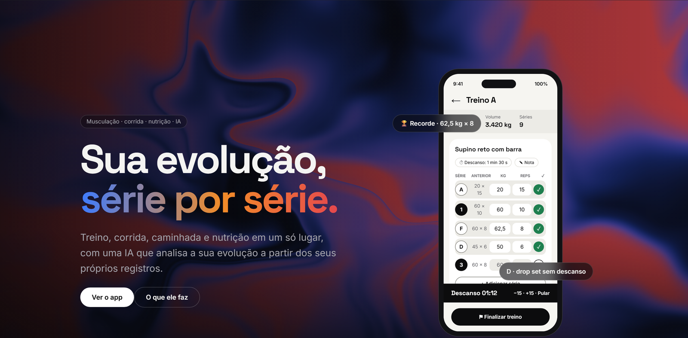
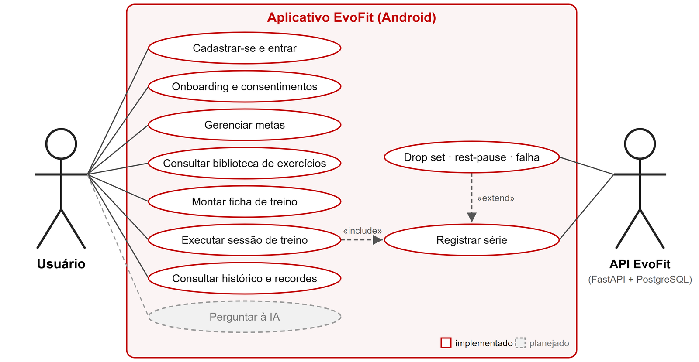
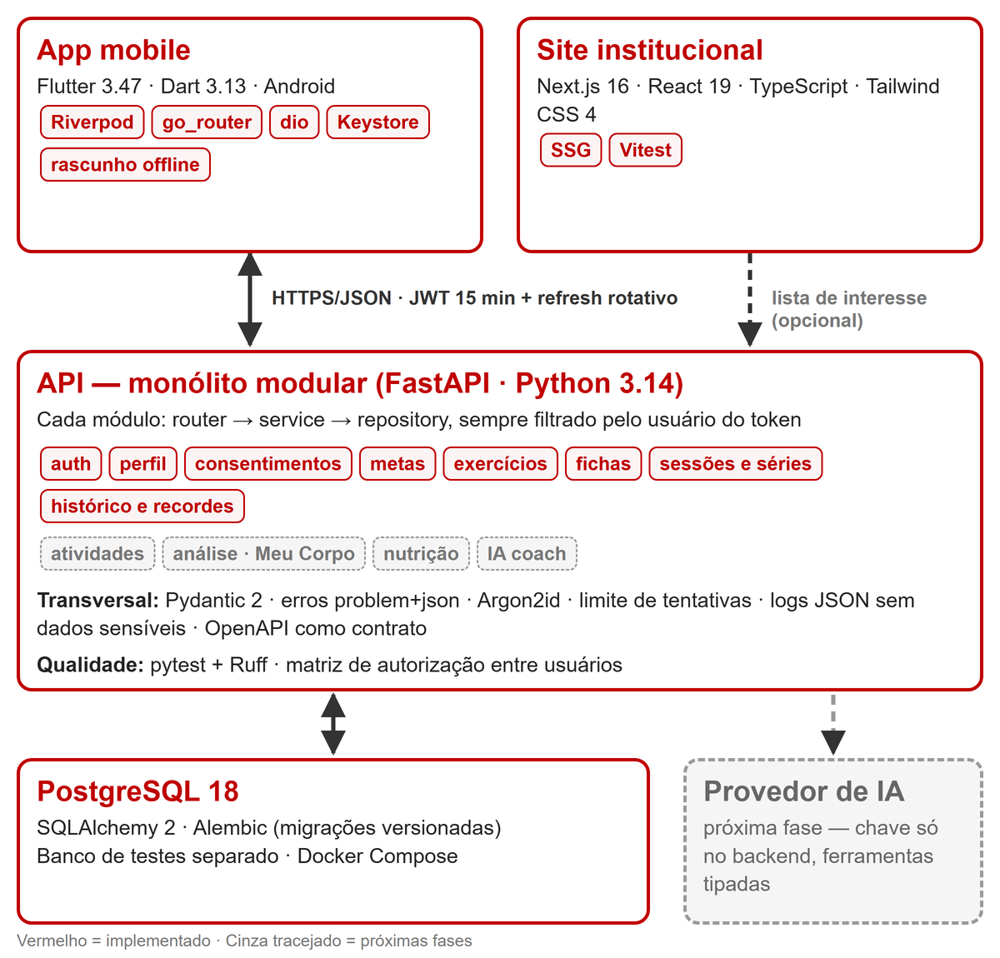

# EvoFit

Plataforma de acompanhamento de atividade física, nutrição e evolução pessoal com IA contextual.

**Projeto de TCC (Portfólio)** · Bacharelado em Engenharia de Software · Católica de Santa Catarina
**Autor:** Vitor Santos · vitor00.santos@catolicasc.edu.br

> “EvoFit” é um nome provisório. O EvoFit não substitui o acompanhamento de profissionais de saúde, Educação Física ou Nutrição.



## Sumário

1. [Contexto e problema](#1-contexto-e-problema)
2. [Justificativa](#2-justificativa)
3. [Objetivos](#3-objetivos)
4. [Escopo](#4-escopo)
5. [Requisitos](#5-requisitos)
6. [Casos de uso](#6-casos-de-uso)
7. [Arquitetura](#7-arquitetura)
8. [Tecnologias](#8-tecnologias)
9. [Segurança e privacidade](#9-segurança-e-privacidade)
10. [Metodologia e pacotes de entrega](#10-metodologia-e-pacotes-de-entrega)
11. [Testes e qualidade](#11-testes-e-qualidade)
12. [Resultados atuais](#12-resultados-atuais)
13. [Como executar](#13-como-executar)
14. [Estrutura do repositório](#14-estrutura-do-repositório)
15. [Documentação](#15-documentação)
16. [Referências](#16-referências)

## 1. Contexto e problema

Quem treina costuma espalhar os registros por vários lugares: um app para a academia, outro para a corrida, uma planilha para a dieta e anotações soltas sobre o peso. Os apps existentes tendem a supor um único perfil, o praticante de musculação focado em hipertrofia. E os assistentes de IA genéricos respondem sem conhecer o histórico real da pessoa.

A Organização Mundial da Saúde recomenda de 150 a 300 minutos semanais de atividade física moderada para adultos (WHO, 2020). Acompanhar a própria evolução de forma simples ajuda a manter essa rotina.

## 2. Justificativa

- **Um só lugar:** reunir musculação, corrida, caminhada, nutrição e medidas corporais, com módulos que o usuário liga conforme o objetivo.
- **Números confiáveis:** todo indicador é calculado pelo backend com regras explícitas e testadas. A IA explica e sugere, sem inventar números.
- **Dados sensíveis tratados com cuidado:** dados de saúde são dados pessoais sensíveis pela LGPD (BRASIL, 2018) e exigem consentimento específico, minimização e controle do titular.

## 3. Objetivos

**Objetivo geral:** desenvolver o EvoFit, uma plataforma (app Android, API e site) de acompanhamento de atividade física, nutrição e evolução pessoal, com uma IA contextual que responde a partir dos dados reais do usuário e só altera fichas ou metas com a confirmação dele.

**Objetivos específicos:**

1. Permitir o registro rápido de treinos de musculação, com técnicas avançadas (drop set, rest-pause, até a falha, aquecimento) e grupos (bi-set, tri-set, supersérie).
2. Registrar corrida, caminhada, ciclismo e natação em um modelo multimodal.
3. Calcular histórico, recordes, tendências e o estímulo por grupo muscular (tela **Meu Corpo**).
4. Oferecer uma IA contextual que consulta os dados por ferramentas tipadas e reconhece quando faltam dados.
5. Garantir privacidade por padrão e isolamento total dos dados entre usuários.

**Personas de referência** (exemplos, não usuários reais): iniciante em caminhada, corredor iniciante, praticante de musculação e perfil híbrido (musculação + corrida + dieta). Detalhes em [VISION](docs/VISION.md).

## 4. Escopo

**Dentro do TCC:**

- Cadastro, login, sessão e perfil com objetivos, modalidades, equipamentos e consentimentos.
- Musculação completa: biblioteca, fichas, sessões, séries, técnicas avançadas, histórico e recordes.
- Corrida e caminhada com registro manual, metas e planos iniciais de 5 km e 10 km; ciclismo e natação básicos.
- Evolução: indicadores, gráficos, comparativos e Meu Corpo em 2D (frente/costas).
- IA contextual com propostas de alteração confirmadas pelo usuário.
- Nutrição básica (refeições, macros estimados, metas diárias), peso e medidas.
- Site institucional.

**Fora do TCC (a arquitetura já prevê):** GPS em tempo real, Strava, Health Connect e wearables; modelo anatômico 3D; versão iOS publicada; monetização, multi-idioma e recursos sociais.

## 5. Requisitos

### Requisitos funcionais

| ID | Requisito | Situação |
|---|---|---|
| RF01 | Cadastrar-se, entrar, renovar a sessão e sair | ✅ |
| RF02 | Completar o onboarding: objetivo, modalidades, experiência, disponibilidade, equipamentos e limitações | ✅ |
| RF03 | Conceder e revogar consentimentos (termos, dados de saúde, uso de IA) | ✅ |
| RF04 | Criar, editar, concluir e excluir metas | ✅ |
| RF05 | Consultar a biblioteca de exercícios com busca e filtros, e criar exercícios próprios | ✅ |
| RF06 | Montar fichas de treino com ordenação e grupos (bi-set, tri-set, supersérie) | ✅ |
| RF07 | Executar a sessão de treino com séries pré-preenchidas pela última sessão e cronômetro de descanso | ✅ |
| RF08 | Registrar drop set, rest-pause, série até a falha e aquecimento | ✅ |
| RF09 | Consultar o histórico, os recordes e a comparação com a sessão anterior | ✅ |
| RF10 | Continuar a sessão em andamento depois de fechar o app ou ficar sem internet | ✅ |
| RF11 | Registrar corrida, caminhada, ciclismo e natação, com pace calculado | 🔜 Fase 3 |
| RF12 | Visualizar o Meu Corpo 2D com o estímulo por grupo muscular | 🔜 Fase 3 |
| RF13 | Ver dashboard, gráficos e comparativos de períodos | 🔜 Fase 3 |
| RF14 | Conversar com a IA sobre o próprio histórico e confirmar ou recusar propostas | 🔜 Fase 4 |
| RF15 | Registrar refeições, metas nutricionais, peso e medidas | 🔜 Fase 5 |
| RF16 | Exportar os dados e excluir a conta (LGPD) | 🔜 Fase 5 |

### Requisitos não funcionais

| ID | Requisito |
|---|---|
| RNF01 | **Segurança:** senhas com Argon2id; access token JWT de 15 min e refresh token rotativo com detecção de reutilização; limite de tentativas no login. |
| RNF02 | **Autorização:** nenhum usuário acessa dados de outro, verificado por testes automatizados em todos os endpoints. |
| RNF03 | **Privacidade (LGPD):** consentimento específico para dados de saúde e para a IA; revogar o consentimento apaga os dados de saúde; logs sem dados sensíveis. |
| RNF04 | **Usabilidade:** registrar uma série em até 2 toques, sem trocar de tela. |
| RNF05 | **Acessibilidade:** suporte a TalkBack, foco visível, fonte grande e redução de movimento (WCAG 2.2). |
| RNF06 | **Resiliência:** a sessão de treino continua offline e sincroniza quando a rede volta. |
| RNF07 | **Manutenibilidade:** monólito modular, OpenAPI como contrato e decisões registradas em ADRs. |
| RNF08 | **Qualidade:** testes automatizados e lint no backend, no app e no site. |
| RNF09 | **Reprodutibilidade:** ambiente local com Docker Compose ou PostgreSQL local e versões fixadas. |
| RNF10 | **Honestidade dos dados:** estimativas (como o 1RM) aparecem como estimativa; métricas não registradas não são exibidas. |

## 6. Casos de uso

O usuário se cadastra, configura objetivos e consentimentos, monta fichas e executa a sessão registrando cada série. As técnicas avançadas estendem o registro da série.



Fluxos detalhados em [UX_FLOWS](docs/UX_FLOWS.md).

## 7. Arquitetura

Um **monólito modular** em FastAPI atende o app e o site. Cada módulo separa `router → service → repository`, e todo repositório recebe o `user_id` do token, nunca do corpo da requisição. O app e o site nunca falam direto com o provedor de IA: as chaves ficam só no backend.



Detalhes em [ARCHITECTURE](docs/ARCHITECTURE.md), modelo de dados em [DATA_MODEL](docs/DATA_MODEL.md) e endpoints em [API](docs/API.md).

## 8. Tecnologias

| Parte | Tecnologia |
|---|---|
| App mobile (`apps/mobile`) | Flutter 3.47 · Dart 3.13 · Riverpod · go_router · dio · flutter_secure_storage (alvo: Android) |
| API (`services/api`) | Python 3.14 · FastAPI · Pydantic 2 · SQLAlchemy 2 · Alembic · PostgreSQL 18 |
| Site (`apps/web`) | Next.js 16 · React 19 · TypeScript · Tailwind CSS 4 |
| IA | Camada própria desacoplada do fornecedor, com ferramentas tipadas (provedor a definir — ADR-012) |
| Testes e qualidade | pytest · Ruff · flutter_test · flutter analyze · Vitest · ESLint |
| Infra local | Docker Compose ou PostgreSQL 18 local (`DB_MODE`) |
| Identidade visual | `packages/design-tokens/tokens.json`, gerado para Dart e CSS |

As versões exatas estão fixadas em `pyproject.toml`, `pubspec.yaml` e `package.json` (ADR-019 e ADR-021).

## 9. Segurança e privacidade

- **Autenticação:** Argon2id (BIRYUKOV et al., 2021) e JWT HS256 de 15 min (JONES; BRADLEY; SAKIMURA, 2015), com refresh opaco de 256 bits guardado só como SHA-256.
- **No app:** refresh token no Android Keystore; access token só em memória; backup automático do Android desligado.
- **Autorização:** matriz única de testes ligada ao OpenAPI. Se surgir um endpoint novo sem classificação, a suíte quebra (ADR-038). Segue o OWASP API Security Top 10 (OWASP, 2023).
- **Dados de saúde:** só com o consentimento `health_data`; revogar apaga limitações e metas de peso (ADR-026).
- **Segredos:** só em variáveis de ambiente; `.env` fora do Git.

Detalhes e pendências jurídicas em [SECURITY_PRIVACY](docs/SECURITY_PRIVACY.md).

## 10. Metodologia e pacotes de entrega

O desenvolvimento é **incremental**: cada fase termina com uma jornada demonstrável, os testes passando e a documentação atualizada. O backlog é priorizado em P0 (indispensável), P1 (importante) e P2 (desejável). As decisões técnicas são registradas como ADRs (NYGARD, 2011) em [DECISIONS](docs/DECISIONS.md) — 38 até agora. Os commits seguem o padrão de commits convencionais (`feat:`, `test:`, ...).

| Pacote | Conteúdo | Situação |
|---|---|---|
| Fase 0 — Planejamento | Ambiente, viabilidade, riscos, arquitetura, modelo de dados, IA, UX e segurança | ✅ |
| Fase 1 — Fundação técnica | Monorepo, API com `/health`, migrações, app e site com testes e lint, scripts | ✅ |
| Fase 2 — Musculação | Auth, onboarding, metas, biblioteca, fichas, sessão, técnicas, histórico, rascunho offline, testes de autorização | ✅ 2.1 a 2.10 (falta validar o aceite) |
| Fase 3 — Evolução e modalidades | Atividades multimodais, motor de análise, Meu Corpo 2D, gráficos, dashboard | 🔜 |
| Fase 4 — IA contextual | Camada de LLM, ferramentas, orquestrador, chat, propostas com confirmação | 🔜 |
| Fase 5 — Nutrição e refinamento | Alimentos, metas, peso e medidas, site completo, LGPD, testes de usabilidade | 🔜 |
| Fase 6 — Demonstração | Dados de demonstração, testes de integração, APK de release, documentação final | 🔜 |

Backlog completo e critérios de aceite em [ROADMAP](docs/ROADMAP.md).

## 11. Testes e qualidade

| Parte | Ferramentas | Testes |
|---|---|---|
| API | pytest (com PostgreSQL de teste) · Ruff (lint e formatação) | 344 |
| App | flutter_test (widget e fluxo) · flutter analyze | 175 |
| Site | Vitest · ESLint · TypeScript | 6 |

São **525 testes automatizados**, todos passando em 2026-11-04. Um único script roda todas as verificações:

```powershell
.\scripts\test-all.ps1                 # tudo
.\scripts\test-all.ps1 -Only api,web   # só algumas partes
```

## 12. Resultados atuais

As etapas 2.1 a 2.10 estão concluídas na API e no app Android: cadastro e login, onboarding com consentimentos, metas, biblioteca com 67 exercícios com fotos (ADR-030), fichas com grupos, sessão de treino com técnicas avançadas, histórico e recordes, rascunho offline da sessão e testes de autorização entre usuários.

**Próximo:** validar o critério de aceite da Fase 2 no Android com um usuário novo (criar ficha com bi-set e drop set, executar a sessão, fechar e reabrir o app, finalizar e ver histórico e recordes) e começar a Fase 3 (corrida e caminhada, motor de análise e Meu Corpo 2D).

## 13. Como executar

Pré-requisitos: Git, Python 3.14, Node.js 24, Flutter 3.47 com Android SDK e emulador, e Docker Desktop ou PostgreSQL 18 local. Passo a passo em [SETUP](docs/SETUP.md).

```powershell
Copy-Item .env.example .env
.\scripts\dev-api.ps1                     # banco + migrações + API em http://localhost:8000/docs
cd apps/mobile; flutter run               # com o emulador aberto
cd apps/web; npm install; npm run dev     # http://localhost:3000
```

Roteiro do dia a dia (depois de ligar o PC) em [COMO_INICIAR](docs/COMO_INICIAR.md).

## 14. Estrutura do repositório

```
apps/mobile/            app Flutter (Android)
apps/web/               site institucional (Next.js)
services/api/           API FastAPI + Alembic + testes
packages/design-tokens/ identidade visual compartilhada (tokens.json)
scripts/                dev-api, test-all, generate_tokens
docs/                   planejamento, decisões e diagramas (docs/img)
```

## 15. Documentação

| Documento | Conteúdo |
|---|---|
| [ASSESSMENT](docs/ASSESSMENT.md) | Ambiente inspecionado, viabilidade, riscos, dependências externas |
| [VISION](docs/VISION.md) | Problema, princípios, personas, escopo e critérios de sucesso |
| [ARCHITECTURE](docs/ARCHITECTURE.md) | Monólito modular, estrutura de pastas, app, site, integrações |
| [DATA_MODEL](docs/DATA_MODEL.md) | Entidades, técnicas avançadas, metodologia de estímulo muscular |
| [API](docs/API.md) | Convenções e mapa de endpoints por fase |
| [AI_DESIGN](docs/AI_DESIGN.md) | Ferramentas, guardrails, confirmação de alterações, testes, custos |
| [UX_FLOWS](docs/UX_FLOWS.md) | Navegação, fluxos críticos, identidade visual |
| [SECURITY_PRIVACY](docs/SECURITY_PRIVACY.md) | Autorização, segredos, LGPD, retenção, pendências jurídicas |
| [DECISIONS](docs/DECISIONS.md) | Registro de decisões (ADRs) |
| [ROADMAP](docs/ROADMAP.md) | Fases, backlog priorizado e critérios de aceite |
| [SETUP](docs/SETUP.md) | Instalação e execução no Windows |
| [COMO_INICIAR](docs/COMO_INICIAR.md) | Como iniciar tudo depois de ligar o PC |

## 16. Referências

- BIRYUKOV, A. et al. **RFC 9106: Argon2 memory-hard function for password hashing and proof-of-work applications**. IETF, 2021.
- BRASIL. **Lei nº 13.709, de 14 de agosto de 2018**. Lei Geral de Proteção de Dados Pessoais (LGPD). Brasília, DF, 2018.
- JONES, M.; BRADLEY, J.; SAKIMURA, N. **RFC 7519: JSON Web Token (JWT)**. IETF, 2015.
- NYGARD, Michael. **Documenting architecture decisions**. Cognitect, 2011.
- OWASP FOUNDATION. **OWASP API Security Top 10**: 2023. 2023.
- W3C. **Web Content Accessibility Guidelines (WCAG) 2.2**. 2023.
- WORLD HEALTH ORGANIZATION. **WHO guidelines on physical activity and sedentary behaviour**. Geneva: WHO, 2020.
